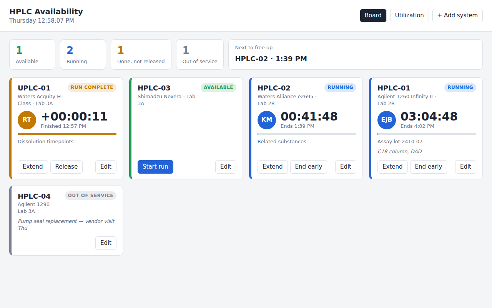

# HPLC Availability Dashboard

A shared, live board showing every HPLC system in the lab: who is running it (analyst initials), a countdown to when the run finishes, and which instruments are free right now. It is meant to help lab management schedule work and decide on instrument purchases using real usage data.



Each instrument card has one of four statuses:

| Status | Meaning |
| --- | --- |
| **Available** | Free to use. Click **Start run**. |
| **Running** | Shows the analyst's initials, a live countdown, the expected finish time and a progress bar. |
| **Run complete** | The timer has finished but the analyst hasn't released the system yet. The card counts *up* so you can see how long it has been sitting. |
| **Out of service** | Under maintenance or repair. No runs can be started. |

The board sorts cards in that order (instruments waiting to be released first, then free ones, then running ones by finish time), and the summary bar shows counts plus **Next to free up**.

## Running it

It needs only Python 3.8 or newer, with no packages to install.

```bash
cd hplc_dashboard
python server.py --host 0.0.0.0 --port 8080
```

Then open `http://<that-pc's-name-or-IP>:8080` from any browser on the lab network. Data is stored in `hplc.db` (SQLite) next to the script. Use `--db` to put it somewhere backed up.

- **Wall display / TV:** open `http://…:8080/?kiosk` to hide the buttons and enlarge the timers.
- The page refreshes every 10 seconds, and countdowns tick every second. Timers are synced to the server clock, so a PC with the wrong time still shows correct countdowns.

## Using it

1. **+ Add system**: register each instrument (name, model, location, plus notes such as the installed column or detector).
2. **Start run**: enter initials and either:
   - **Sequence**: injections × minutes per injection + equilibration/wash time, or
   - **Total time**: hours and minutes.

   The dialog shows the expected finish time before you confirm. Your initials are remembered in that browser.
3. **Extend**: add time if the sequence runs long. Extending a completed run counts from now.
4. **Release** / **End early**: mark the instrument free.
5. **Edit**: rename the system, change notes, or toggle **Out of service**.

## Utilization (for procurement)

The **Utilization** tab shows, for each system over the last 7, 30 or 90 days, the percentage of time it was in use, instrument hours, and run count, followed by a log of recent runs.

Instrument time is counted from start until the timer ended or the system was released, whichever came first. A run that was left unreleased overnight therefore doesn't inflate the numbers.

## API

All endpoints use JSON.

| Method | Path | Body |
| --- | --- | --- |
| GET | `/api/state` | |
| GET | `/api/history?days=7` | |
| POST | `/api/systems` | `{name, model?, location?, notes?}` |
| PATCH | `/api/systems/{id}` | any of `{name, model, location, notes, out_of_service}` |
| DELETE | `/api/systems/{id}` | |
| POST | `/api/systems/{id}/runs` | `{analyst, duration_minutes, description?}` |
| POST | `/api/runs/{id}/extend` | `{minutes}` |
| POST | `/api/runs/{id}/finish` | |

## Tests

```bash
cd hplc_dashboard
python -m unittest -v
```

## Notes and limitations

- There is no login. Anyone who can reach the page can edit it, which is fine on a trusted lab network but you shouldn't expose it to the internet.
- Run durations are the analyst's estimate. The board does not talk to the instruments or the CDS (Empower, OpenLab, Chromeleon).
